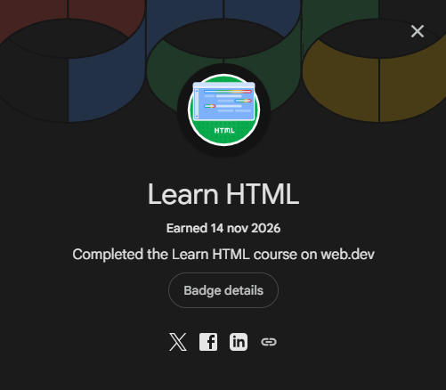

# Portafolio Web Personal

Proyecto práctico para la clase de Fundamentos de Programación Web. Es un portafolio estático que armé aplicando lo que aprendí en el curso Learn HTML de web.dev.

## Qué incluye

- Estructura semántica (`header`, `nav`, `main`, `section`, `article`, `footer`).
- Formulario de contacto con validación nativa (required, type email, pattern para el teléfono).
- Modal con la etiqueta `<dialog>` nativa, sin librerías.
- Preguntas frecuentes con `
` y `
`.
- Componente reutilizable con `<template>` y Shadow DOM para las tarjetas de habilidades.

## Decisiones de arquitectura

Usé etiquetas semánticas en lugar de `
` porque mejoran el SEO y el árbol de accesibilidad. Un lector de pantalla puede navegar directamente a `<nav>` o `<main>` sin adivinar. También añadí el enlace "Saltar al contenido principal" para que quienes navegan con teclado no tengan que recorrer todo el menú.

El formulario valida en el cliente (el navegador) antes de enviar. Eso evita idas innecesarias al backend. Usé `POST` porque los datos son privados y no quiero que viajen en la URL.

El `<dialog>` nativo atrapa el foco del teclado automáticamente, lo cual es difícil de lograr con un `
` y JavaScript puro.

El Shadow DOM de las tarjetas de habilidades encapsula los estilos. Si en el futuro otro desarrollador añade CSS global, las tarjetas no se verán afectadas.

## Badge del curso

## Cómo verlo

Clona el repo y abre `index.html` en tu navegador. O visita la versión en línea: https://github.com/Alejo-Piedrahita/portafolio-web.git